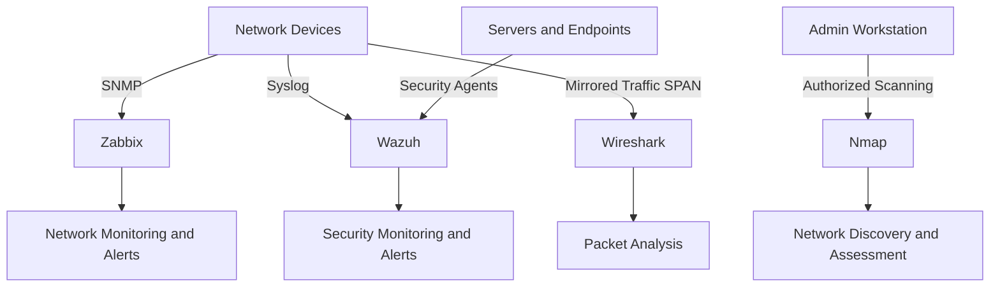

# Home Lab | Network & Security Engineering

A hands-on enterprise IT environment for designing, deploying, securing, monitoring, and troubleshooting network and system infrastructures.

## 1. Lab Equipment

- Cisco ISR 4331 Router
- 2 × Cisco ASA 5516-X Firewalls
- Cisco Catalyst 3560-X Core Switch
- 2 × Cisco Catalyst 3750 V2 Distribution Switches
- Cisco Catalyst 2960 Access Switch

## 2. Enterprise Networking

**Routing and Layer 3**
- Static Routing, OSPF, EIGRP, BGP and RIP
- IPv4 and IPv6
- Route Redistribution and Summarization
- Policy-Based Routing

**Switching and Layer 2**
- VLANs and 802.1Q Trunking
- STP, RSTP and MSTP
- EtherChannel, LACP and PAgP
- Inter-VLAN Routing
- HSRP, VRRP and GLBP

**WAN and VPN Technologies**
- GRE Tunneling
- IPsec Site-to-Site VPN
- Remote Access VPN
- DMVPN
- WAN Connectivity

## 3. Network and Infrastructure Security

- Cisco ASA Firewall Configuration
- Access Control Lists (ACLs)
- NAT and PAT
- Network Segmentation
- Port Security
- DHCP Snooping and Dynamic ARP Inspection
- AAA, RADIUS and TACACS+
- Secure Network Access

## 4. Enterprise Infrastructure Services

- DHCP and DNS
- NTP and SSH
- SNMP and Syslog
- Quality of Service (QoS)
- Network Addressing and Subnetting
- Network Discovery and Management

## 5. Monitoring and Security Architecture

**Monitoring and security tools:**
- Zabbix — Network and Infrastructure Monitoring
- Wazuh — Security Monitoring and Analysis
- Wireshark — Packet Capture and Traffic Analysis
- Nmap — Network Discovery and Security Assessment

### Planned Monitoring Architecture

## 6. Engineering Objectives

- Design and deploy enterprise network architectures.
- Implement routing, switching and WAN technologies.
- Configure firewalls and secure network infrastructure.
- Develop VPN connectivity and network redundancy.
- Deploy monitoring and security solutions.
- Document configurations, diagrams and technical procedures.
- Perform troubleshooting and authorized security testing.

## 7. Project Status

**Status: In Progress**

All technologies are planned learning and implementation areas. Hardware, software, licensing and feature compatibility will be verified before deployment.

## 8. Security

All configurations and testing will be performed in an authorized lab environment. Passwords, credentials, private keys, tokens and sensitive network information will never be published.
